# 1. Identidad del proyecto

## 1.1 Información general

| Campo | Detalle |
|---|---|
| Nombre | MallMapAI — Sistema Interactivo de Navegación 2D y Cálculo de Rutas para Unicentro Bogotá |
| Curso | Taller de Programación, Universidad Manuela Beltrán |
| Docente | Juan José Osorio Tabares |
| Tipo de entrega | Prototipo funcional con sector piloto (Fase 2) |
| Fecha | 18 de noviembre de 2026 |

## 1.2 Equipo de trabajo

| Integrante | Rol en la propuesta | Aporte principal en esta fase |
|---|---|---|
| María Fernanda López Ballen | Desarrolladora fullstack, líder de frontend | Interfaz React, mapa SVG, planificador, vista de ofertas |
| Eduardo Stiven Prieto Espitia | Desarrollador fullstack, líder de backend | Modelo de datos, PostgreSQL, API Express, anotación del grafo |
| Juan Pablo Salinas Chavarro | Desarrollador fullstack, líder de automatización | Importador Python, pruebas y evidencias |

Los roles salen de la propuesta de la Fase 1 (López Ballen et al., 2026).

# 2. Fundamentación y destino

## 2.1 Problema

Ubicarse en un centro comercial de varios pisos es difícil. La encuesta de la Fase 1 tuvo 38 respuestas de personas de Bogotá (López Ballen et al., 2026). Estos son los resultados que se pueden verificar en la propuesta:

- El 81,5 % pierde entre 5 y 30 minutos buscando un local. El 50 % pierde más de 15 minutos.
- La mitad califica como alta la dificultad para orientarse entre pisos. El promedio fue 3,37 sobre 5 y el nivel 5 fue la respuesta más común (26,3 %).
- El 47,4 % no sabe en qué piso o pasillo está la tienda. El 44,7 % encuentra mapas o directorios confusos o desactualizados. El 39,5 % da vueltas buscando escaleras o ascensores.
- El 52,7 % casi no aprovecha ofertas mientras camina. Sumando «a veces» y «rara vez», el 86,6 % las desaprovecha.
- El 81,6 % se entera de ofertas por redes sociales. Solo el 10,5 % dijo no estar interesado en notificaciones.

**Notas de verificación.** La introducción de la propuesta dice 81,6 % para el tiempo perdido, pero el análisis de la pregunta 3 dice 81,5 %. Aquí usamos 81,5 %, que es el dato de la gráfica analizada. En la pregunta 8 aparece 47,7 %; con 38 personas ese valor no es posible (18 de 38 = 47,4 %). Lo dejamos como lo reporta la propuesta y lo marcamos para revisión.

## 2.2 Justificación

Una aplicación web liviana puede mostrar el plano, trazar la ruta más corta entre dos puntos y conectar las ofertas con el mapa. No hay que instalar nada: funciona en el navegador del celular.

## 2.3 Población objetivo

Visitantes de Unicentro Bogotá, sobre todo quienes van poco (55,3 % de los encuestados va con poca frecuencia). También se benefician los comercios, porque sus ofertas llevan al visitante hasta el local.

# 3. Hoja de ruta técnica

## 3.1 Objetivo general

Desarrollar una aplicación web adaptable a celular con un mapa 2D interactivo que calcule la ruta más corta entre dos puntos de Unicentro y que conecte las ofertas de las tiendas con esa ruta.

## 3.2 Objetivos específicos y estado

| Objetivo de la propuesta | Estado en este prototipo |
|---|---|
| Digitalizar y estructurar el plano en SVG con coordenadas y grafo | **Cumplido para el sector piloto.** Se usaron los tres SVG entregados sin cambios y se anotaron 115 nodos y 121 conexiones. |
| Implementar el enrutamiento con Dijkstra | **Cumplido.** Módulo JavaScript independiente con filtro «Evitar escaleras». |
| Automatizar la captura semanal de ofertas con web scraping | **Parcial.** Importador Python idempotente probado con dos fuentes HTML de muestra. No hay fuentes comerciales autorizadas ni tarea semanal configurada. |
| Integrar la experiencia: oferta → mapa → ruta | **Cumplido.** Flujo probado en navegador de escritorio y en 390 px. |

## 3.3 Arquitectura y tecnologías

| Capa | Tecnología usada | Comentario |
|---|---|---|
| Interfaz | React 19 + Vite 7 | La propuesta mencionaba React / Next.js. Elegimos React con Vite porque no necesitamos renderizado en servidor. |
| Planos y rutas | SVG | Los planos originales se cargan como imagen dentro de un SVG; los marcadores y la ruta se dibujan encima con las mismas coordenadas del `viewBox`. |
| Algoritmo | JavaScript (`shared/dijkstra.js`) | Módulo independiente, sin dependencias. |
| Servidor | Node.js 24 + Express 5 | API REST en `/api/v1`. |
| Base de datos | PostgreSQL 16 | Opciones: Docker Desktop, instalación en Windows o Supabase. |
| Importación | Python 3 + BeautifulSoup | Envía las ofertas a la API con token. |
| Pruebas | node:test, unittest, Playwright | Unitarias, integración, funcionales y de aceptación técnica. |
| Versiones | Git | El ZIP incluye el historial. GitHub queda con instrucciones. |

La Figura 1 resume los componentes.

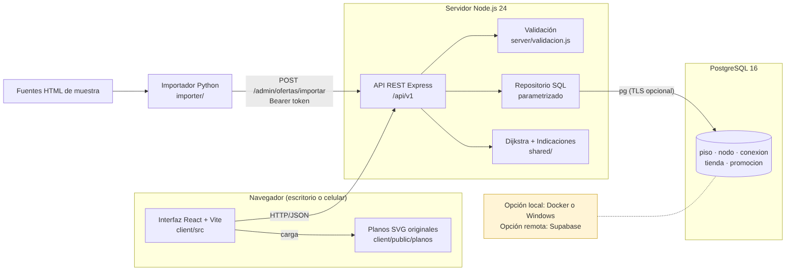{width=100%}

## 3.4 Alcance

**Incluye:**

- Sector piloto: eje central-sur de los pisos 1, 2 y 3. Es la zona donde los tres planos tienen ascensor (verde) y escaleras (amarillo) en posiciones parecidas. Está marcado en el mapa con línea punteada y en la sección «Alcance» de la app.
- Mapa por piso con zoom, desplazamiento, restablecer, leyenda escrita y marcadores seleccionables.
- Rutas entre pisos con Dijkstra, filtro «Evitar escaleras» e indicaciones de texto.
- Ofertas vigentes y flujo «Ir al local».
- CRUD e importación de promociones por API con token.

**No incluye (igual que la propuesta):** posicionamiento automático en interiores, pagos, varios centros comerciales y cobertura de todos los locales.

**Queda pendiente:** cuentas de usuario con JWT, favoritos, notificaciones, extracción con IA, fuentes comerciales reales y validación en sitio.

# 4. Planificación y conceptos

## 4.1 Glosario

- **Nodo:** punto del mapa con coordenadas X, Y. Puede ser pasillo, entrada de local, baño, entrada al centro comercial, ascensor o escalera.
- **Conexión (arista):** enlace entre dos nodos con un costo. Puede ser de un sentido o de dos.
- **Costo:** peso que usa Dijkstra. En este prototipo es la distancia en **unidades del plano**, no en metros. El ascensor y la escalera suman un costo fijo de demostración.
- **viewBox:** sistema de coordenadas interno de cada SVG.
- **Idempotente:** repetir la operación deja el mismo resultado; importar dos veces no duplica.
- **Sector piloto:** parte del centro comercial cubierta por el grafo.

## 4.2 Cronograma

La propuesta definió 6 fases en 12 semanas. Mantuvimos esas fases y las usamos para el presupuesto (sección 16).

| Fase | Contenido | Estado |
|---|---|---|
| 1. Análisis | Requisitos, encuesta, revisión de planos | Hecha en Fase 1 |
| 2. Arquitectura y base de datos | Esquema relacional | Hecha |
| 3. Backend y scraping | API e importador | Hecha (con fuentes de muestra) |
| 4. Frontend y enrutamiento | Interfaz y Dijkstra | Hecha |
| 5. Integración y pruebas E2E | Pruebas técnicas | Hecha; falta prueba con visitantes |
| 6. Cierre | Informe, guion y video | Hecha |

## 4.3 Resultados de la encuesta

Ver la sección 2.1. Los resultados orientaron tres decisiones: ruta paso a paso con indicación de ascensor o escalera, leyenda clara para encontrar conectores verticales y ofertas conectadas con el mapa.

# 5. Conclusiones de la Fase 1

La Fase 1 mostró que el problema existe y que una app liviana es viable. Esta fase lo comprueba con un prototipo que funciona, pero en un sector reducido y con datos de demostración.

# 6. Documentación UML

## 6.1 Casos de uso

Los casos marcados [P] y con línea punteada están pendientes.

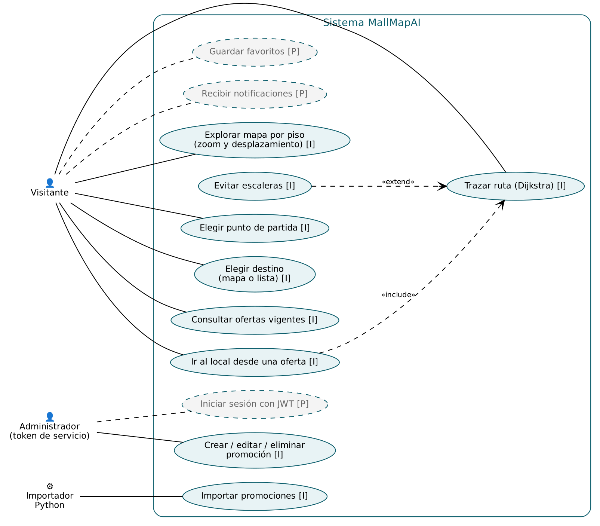{width=85%}

## 6.2 Clases

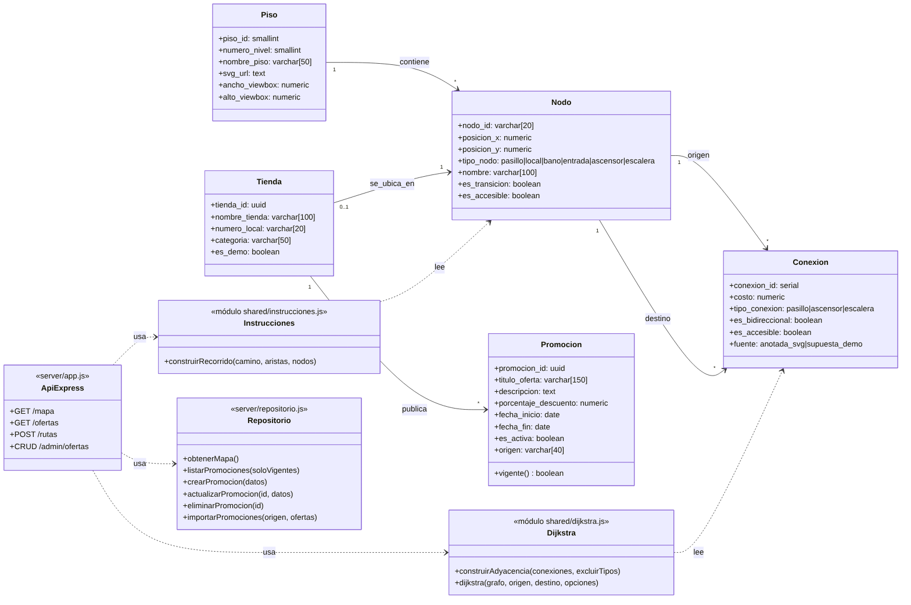{width=100%}

## 6.3 Secuencia: Oferta → Ir al local → Ruta

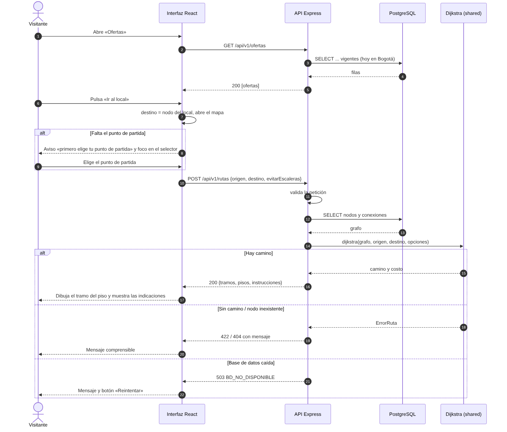{width=95%}

Las fuentes editables están en `docs/uml/` (`.mmd` para Mermaid y `.dot` para Graphviz).

# 7. Modelado de la base de datos

## 7.1 Modelo lógico

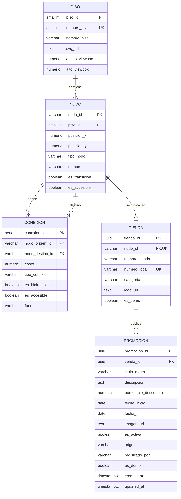{width=100%}

`piso` contiene `nodo`. `conexion` une dos nodos (origen y destino). `tienda` se ubica en un nodo de tipo local. `promocion` pertenece a una tienda.

## 7.2 Diccionario de datos

**piso**

| Atributo | Tipo | Reglas | Significado |
|---|---|---|---|
| piso_id | SMALLINT | PK | Identificador del piso (1, 2, 3) |
| numero_nivel | SMALLINT | NOT NULL, UNIQUE | Nivel del piso |
| nombre_piso | VARCHAR(50) | NOT NULL | Nombre visible |
| svg_url | TEXT | NOT NULL | Ruta del plano SVG original |
| ancho_viewbox, alto_viewbox | NUMERIC(8,2) | NOT NULL, > 0 | Tamaño del `viewBox` del plano |

**nodo**

| Atributo | Tipo | Reglas | Significado |
|---|---|---|---|
| nodo_id | VARCHAR(20) | PK | Código legible, ej. `P1-C03` |
| piso_id | SMALLINT | FK → piso, NOT NULL | Piso del nodo |
| posicion_x, posicion_y | NUMERIC(8,3) | NOT NULL | Coordenadas en el `viewBox` del SVG |
| tipo_nodo | VARCHAR(20) | CHECK (pasillo, local, bano, entrada, ascensor, escalera) | Tipo funcional |
| nombre | VARCHAR(100) | NOT NULL | Nombre visible |
| es_transicion | BOOLEAN | NOT NULL | Verdadero si es ascensor o escalera |
| es_accesible | BOOLEAN | NOT NULL | Según el grafo; **no** es una certificación física |

**conexion**

| Atributo | Tipo | Reglas | Significado |
|---|---|---|---|
| conexion_id | SERIAL | PK | Identificador |
| nodo_origen_id, nodo_destino_id | VARCHAR(20) | FK → nodo; distintos; UNIQUE (origen, destino) | Extremos |
| costo | NUMERIC(8,2) | NOT NULL, > 0 | Peso para Dijkstra, en unidades del plano |
| tipo_conexion | VARCHAR(20) | CHECK (pasillo, ascensor, escalera) | Tipo de enlace |
| es_bidireccional | BOOLEAN | NOT NULL | Falso = un solo sentido |
| es_accesible | BOOLEAN | NOT NULL | Falso para escaleras |
| fuente | VARCHAR(30) | CHECK (anotada_svg, supuesta_demo) | Origen del dato |

**tienda**

| Atributo | Tipo | Reglas | Significado |
|---|---|---|---|
| tienda_id | UUID | PK, gen_random_uuid() | Identificador |
| nodo_id | VARCHAR(20) | FK → nodo, UNIQUE | Entrada del local en el mapa |
| nombre_tienda | VARCHAR(100) | NOT NULL | Nombre (de demostración) |
| numero_local | VARCHAR(20) | NOT NULL, UNIQUE | Código del local (de demostración) |
| categoria | VARCHAR(50) | NULL | Categoría |
| logo_url | TEXT | NULL | Logo (no usado aún) |
| es_demo | BOOLEAN | NOT NULL | Marca de dato de demostración |

**promocion**

| Atributo | Tipo | Reglas | Significado |
|---|---|---|---|
| promocion_id | UUID | PK | Identificador |
| tienda_id | UUID | FK → tienda, ON DELETE CASCADE | Tienda que publica |
| titulo_oferta | VARCHAR(150) | NOT NULL, no vacío | Título |
| descripcion | TEXT | NULL | Condiciones |
| porcentaje_descuento | NUMERIC(5,2) | NULL, > 0 y ≤ 100 | Descuento |
| fecha_inicio, fecha_fin | DATE | NOT NULL, fin ≥ inicio | Vigencia |
| imagen_url | TEXT | NULL | Imagen |
| es_activa | BOOLEAN | NOT NULL | Activación manual |
| origen | VARCHAR(40) | NOT NULL | `manual`, `semilla` o `importador:<fuente>` |
| registrado_por | VARCHAR(60) | NOT NULL | Quién la registró (texto, ver 7.3) |
| es_demo | BOOLEAN | NOT NULL | Marca de demostración |
| created_at, updated_at | TIMESTAMPTZ | NOT NULL | Fechas de registro |
| — | — | UNIQUE (tienda_id, titulo_oferta, fecha_inicio) | Evita duplicados y permite el upsert |

**Regla de vigencia.** Una promoción es vigente si `es_activa` es verdadero y la fecha de hoy en Bogotá está entre `fecha_inicio` y `fecha_fin`, ambas incluidas. Está en la vista `promocion_vigente` y en las consultas de la API.

## 7.3 Diferencias con el modelo de la propuesta

| Propuesta | Implementación | Justificación |
|---|---|---|
| `nodo_id` UUID | VARCHAR legible (`P1-C03`) | Facilita relacionar cada nodo con su punto en el SVG y revisar el grafo a mano. |
| `piso_id` UUID | SMALLINT | Solo hay tres pisos; el número es más claro. |
| `distancia_metros` | `costo` en unidades del plano | Los SVG no tienen escala. No inventamos metros. |
| Tabla `usuario` y `promocion.usuario_id` | Sin tabla de usuarios; `registrado_por` texto | La autenticación con cuentas quedó pendiente (ver sección 9). |
| — | `tipo_conexion`, `fuente`, `origen`, `es_demo` | Para filtrar escaleras, separar datos supuestos y rastrear importaciones. |

## 7.4 Anotación del grafo sobre los SVG

Los SVG tienen círculos de colores. Seguimos la interpretación pedida: rojo = entrada de local, negro = pasillo, amarillo = escaleras, verde = ascensor, morado = baños, azul = entradas principales. Los polígonos grises son locales y paredes; no se usaron como conexiones.

Un punto o una línea no prueba que dos lugares estén conectados. Por eso anotamos a mano cada conexión: unimos puntos negros vecinos que siguen un pasillo libre y unimos cada punto rojo, morado o azul con el punto de pasillo más cercano por el mismo corredor. Luego dibujamos el grafo encima del plano para revisarlo (Anexo B).

- **Pisos 1, 2 y 3:** 115 nodos (35 locales, 4 baños, 2 entradas, 3 ascensores, 6 escaleras y 65 de pasillo).
- **Conexiones horizontales:** 116, con costo igual a la distancia en unidades del `viewBox`.
- **Conexiones verticales:** 5, marcadas como `supuesta_demo`. Ascensor P1↔P2↔P3 (costo 90 por piso, incluye espera) y escaleras P1↔P2 y P2↔P3 (costo 40). La correspondencia entre pisos es un **supuesto**: los ascensores no están en las mismas coordenadas en los tres planos.
- **Escaleras:** el plano no distingue fijas de eléctricas, así que usamos el tipo genérico «escalera».
- **Sentido de circulación:** no se conoce. Todas las conexiones cargadas son de doble sentido. El algoritmo sí soporta un solo sentido y está probado (U-02).

Las tablas completas están en `docs/grafo/nodos.csv` y `docs/grafo/conexiones.csv`.

# 8. Documentación de la API

Base: `/api/v1`. Entradas y salidas en JSON. Los errores tienen la forma `{"error": {"codigo", "mensaje", "detalles"}}`.

| Método | Ruta | Entrada | Respuesta correcta | Errores | Auth |
|---|---|---|---|---|---|
| GET | `/salud` | — | 200 `{estado, baseDeDatos}` | 503 si la base no responde | No |
| GET | `/mapa` | — | 200 `{pisos, nodos, conexiones}` | 503 | No |
| GET | `/tiendas` | — | 200 lista | 503 | No |
| GET | `/ofertas` | — | 200 ofertas vigentes | 503 | No |
| GET | `/ofertas/:id` | UUID | 200 oferta | 400 id inválido, 404 | No |
| POST | `/rutas` | `{origen, destino, evitarEscaleras?}` | 200 `{costoTotal, nodos, aristas, tramos, pisos, instrucciones}` | 400 datos incompletos, 404 nodo inexistente, 422 sin ruta, 503 | No |
| GET | `/admin/ofertas` | — | 200 todas | 401 | Token |
| POST | `/admin/ofertas` | `{tiendaId \| numeroLocal, titulo, descripcion?, porcentaje?, fechaInicio, fechaFin, imagenUrl?, esActiva?}` | 201 oferta | 401, 404 tienda, 409 duplicado, 422 validación | Token |
| PUT | `/admin/ofertas/:id` | igual que POST | 200 oferta | 400, 401, 404, 409, 422 | Token |
| DELETE | `/admin/ofertas/:id` | — | 204 | 400, 401, 404 | Token |
| POST | `/admin/ofertas/importar` | `{origen, ofertas: [...]}` (1 a 500) | 200 `{insertadas, actualizadas, rechazadas}` | 400, 401 | Token |

La propuesta planteaba Pydantic para validar. Como el servidor quedó en Node.js, la validación está en `server/validacion.js` con reglas equivalentes.

# 9. Seguridad y privacidad

## 9.1 Autenticación implementada

La administración usa un **token de servicio**: una cadena larga guardada en la variable `ADMIN_TOKEN` del servidor. Se envía en la cabecera `Authorization: Bearer ...` y se compara en tiempo constante. Si el token falta o tiene menos de 16 caracteres, la administración se desactiva.

**Diferencia con la propuesta.** La propuesta describía cuentas de usuario con contraseña cifrada y JWT. Un token de servicio no identifica a una persona: es una sola llave para el servidor y el importador. No caduca sola y no tiene roles. Sirve para un prototipo, pero no para producción. Queda pendiente: tabla `usuario` con contraseña con hash (bcrypt o argon2), inicio de sesión que emita JWT con caducidad y roles visitante/administrador.

## 9.2 Otras medidas

- Consultas SQL parametrizadas (`$1, $2...`) en todo el servidor.
- Credenciales solo en variables de entorno. Se entrega `.env.example`; `.env` está en `.gitignore` y no va en el ZIP.
- TLS hacia la base configurable (`DB_SSL=no-verify` o `verify` con certificado) para Supabase.
- Límite de 200 KB por petición JSON y mensajes de error sin datos internos.

## 9.3 Privacidad (Ley 1581 de 2012)

El prototipo **no recoge datos personales**: no hay cuentas, el punto de partida se guarda solo en el navegador del visitante y no se envía a ningún registro. Si en el futuro se agregan cuentas o notificaciones, habrá que pedir autorización previa e informar la finalidad, como exige la Ley 1581 de 2012 y su reglamentación (Congreso de la República de Colombia, 2012; Presidencia de la República de Colombia, 2013). El material académico se mantiene privado.

# 10. Diseño de la interfaz de usuario

| Necesidad del visitante (encuesta) | Decisión de diseño |
|---|---|
| No sabe en qué piso está la tienda (47,4 %) | Selector de piso siempre visible. Los pisos que forman parte de la ruta llevan una línea naranja. |
| Busca escaleras y ascensores (39,5 %) | Marcadores con color **y letra** (A = ascensor, S = escaleras) y leyenda escrita. |
| Mapas confusos (44,7 %) | Se usa el plano original, con zoom, desplazamiento, «Restablecer» y «Plano completo». |
| Quiere ruta paso a paso | Indicaciones numeradas que dicen qué conector tomar y de qué piso a qué piso. Botones «Ver Piso N» para revisar cada tramo. |
| Desaprovecha ofertas (86,6 %) | Pestaña «Ofertas» con tarjetas y botón «Ir al local» que abre la ruta. |
| Usa el celular | Diseño móvil primero; botones de al menos 44 px; pellizco para zoom. Verificado a 390 px. |
| Personas con movilidad reducida | Opción «Evitar escaleras», con nota de que la accesibilidad física se verifica en sitio. |

Accesibilidad: interfaz en español, etiquetas en todos los campos, foco visible amarillo, marcadores alcanzables con Tab y activables con Enter, mapa manejable con flechas y + / −, mensajes en regiones `role="alert"`. Seguimos como guía WCAG 2.2 (W3C, 2023), sin hacer una auditoría formal.

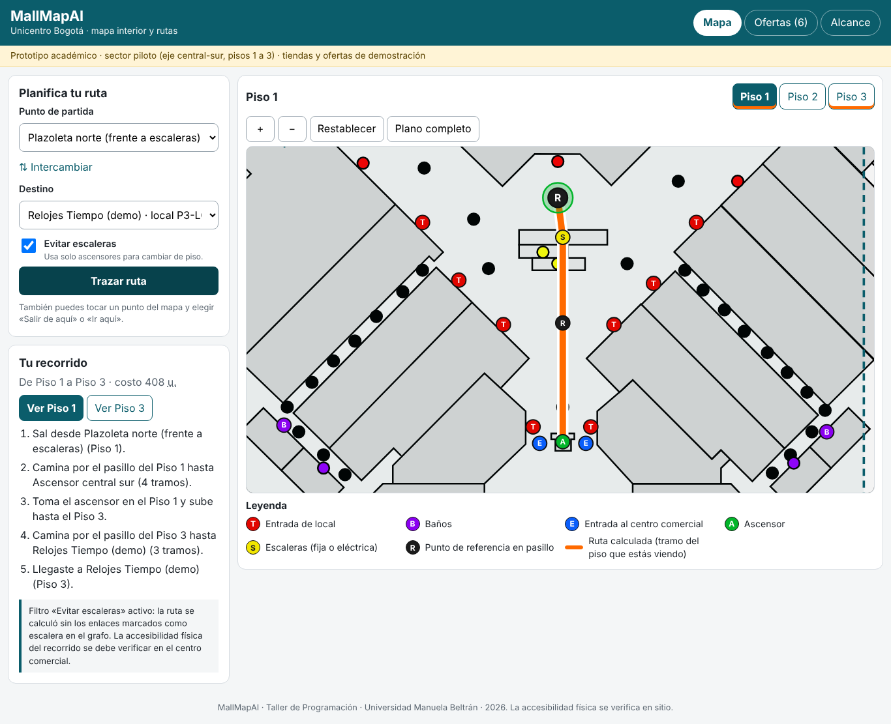{width=100%}

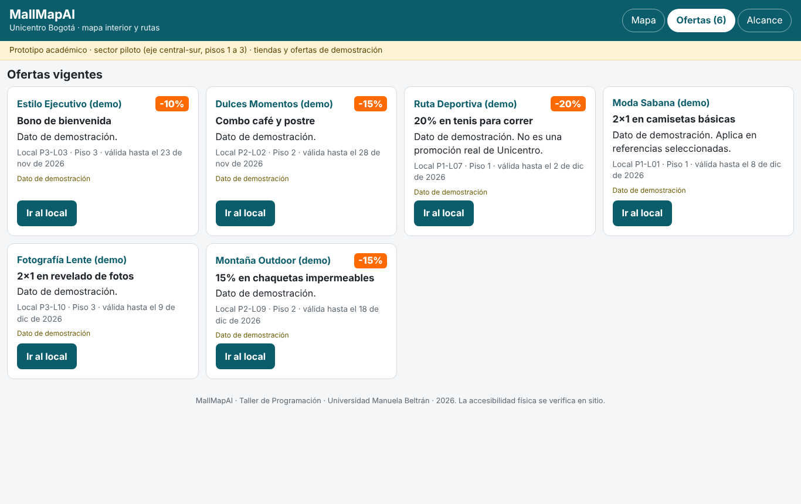{width=100%}

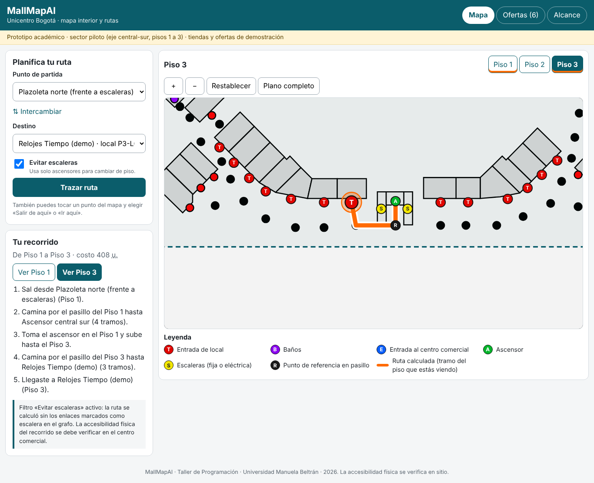{width=100%}

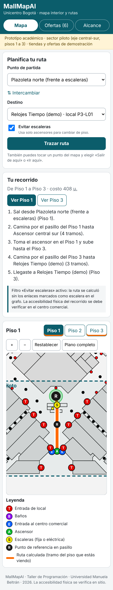{width=40%}

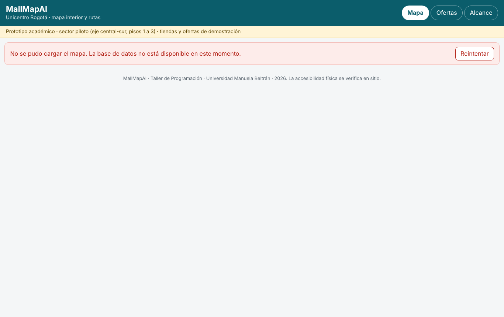{width=80%}

# 11. Desarrollo e implementación

## 11.1 Organización del código

| Carpeta | Responsabilidad |
|---|---|
| `client/` | Interfaz React. `App.jsx` maneja el estado; `Mapa.jsx` el SVG, zoom y marcadores; `Paneles.jsx` el planificador, recorrido, ofertas y estados. |
| `server/` | `app.js` (rutas y errores), `db.js` (conexión), `repositorio.js` (SQL), `validacion.js`, `config.js`. |
| `shared/` | `dijkstra.js` e `instrucciones.js`, sin dependencias. |
| `db/` | `schema.sql` y `seed.sql` (generado desde `data/`). |
| `importer/` | Importador Python y fuentes de muestra. |
| `tests/` | Pruebas unitarias, de integración, E2E y del importador. |

## 11.2 Dijkstra

Se usa una cola de prioridad (montículo binario). Cada conexión bidireccional se agrega en los dos sentidos y una de un solo sentido solo en el suyo. Con «Evitar escaleras» las conexiones de tipo `escalera` se quitan **antes** de calcular. El algoritmo garantiza el camino de menor costo cuando los costos no son negativos (Dijkstra, 1959; Cormen et al., 2022). Por eso se rechazan costos negativos.

Casos manejados: origen igual a destino (costo 0), nodo inexistente (404), datos incompletos (400) y destino inalcanzable (422, con un mensaje distinto si el filtro de escaleras es la causa).

## 11.3 Indicaciones

`construirRecorrido` agrupa el camino en tramos por piso y junta los cambios de piso seguidos del mismo tipo. Así «ascensor 1→2» y «ascensor 2→3» se leen como «Toma el ascensor en el Piso 1 y sube hasta el Piso 3». Un piso por el que solo se pasa dentro del ascensor no aparece como tramo.

## 11.4 Por qué el ascensor cuesta 90

Con un costo de 60 por piso el ascensor ganaba siempre del piso 1 al 3 y el filtro no cambiaba nada. La propuesta dice que Dijkstra pondera «la distancia física y el tiempo de transición». Por eso subimos el ascensor a 90 por piso (representa la espera). Es un valor de demostración y se debe calibrar con mediciones reales.

## 11.5 Diferencias con la propuesta

| Propuesta | Implementación | Motivo |
|---|---|---|
| React / Next.js | React + Vite | No se necesita renderizado en servidor; Vite es más simple de ejecutar. |
| Planos convertidos a SVG desde Figma | Se usaron los tres SVG entregados, sin modificar | Requisito de esta fase. |
| Supabase como infraestructura principal | PostgreSQL local (Docker o Windows) y Supabase como opción remota | Facilita trabajar sin cuenta externa. Supabase no se pudo verificar en esta entrega (sección 15). |
| Pydantic | Validación en Node.js | El servidor quedó en Node.js. |
| JWT con usuarios | Token de servicio | Ver 9.1. |
| Scraping con IA de tiendas ancla | Importador de dos fuentes HTML de muestra | No hay fuentes autorizadas; no usamos IA. |
| Botón «Aceptar oferta» | Botón «Ir al local» | Nombre más claro para la acción. |
| Endpoints `/favoritos` y notificaciones | No implementados | Pendientes. |

# 12. Persistencia y gestión de datos

## 12.1 Creación y carga

`npm run db:init` ejecuta `db/schema.sql` y `db/seed.sql`. El `seed.sql` se genera con `npm run db:seed-sql` a partir de `data/grafo-sector.json`, `data/tiendas-demo.json` y `data/promociones-demo.json`. Las fechas de las promociones de la semilla son relativas al día de la carga (`CURRENT_DATE + n`) para que la demo siempre tenga ofertas vigentes. Una de ellas vence a propósito para probar el filtro de vigencia.

## 12.2 Operaciones disponibles

| Operación | Interfaz | API | SQL |
|---|---|---|---|
| Consultar mapa, tiendas y ofertas | Sí | GET | SELECT |
| Calcular ruta | Sí | POST `/rutas` | — |
| Crear / actualizar / eliminar promoción | No (prototipo sin panel) | POST / PUT / DELETE con token | INSERT / UPDATE / DELETE |
| Importar promociones | — | POST `/admin/ofertas/importar` | INSERT ... ON CONFLICT |
| Editar nodos, conexiones y tiendas | No | No | Editando `data/*.json` y regenerando `seed.sql`, o con SQL directo |

## 12.3 Importador

`importer/importar_promociones.py` lee dos fuentes:

| Fuente | Formato | Selectores | Fechas |
|---|---|---|---|
| `fuente_a.html` | Tarjetas | `article.oferta[data-local]`, `.oferta__titulo`, `.oferta__detalle`, `.oferta__descuento`, `time.oferta__inicio[datetime]`, `time.oferta__fin[datetime]` | AAAA-MM-DD |
| `fuente_b.html` | Tabla | `table#tabla-promos tbody tr`, 6 columnas | DD/MM/AAAA |

La API aplica un *upsert* con `ON CONFLICT (tienda_id, titulo_oferta, fecha_inicio)`. Cada oferta va en un `SAVEPOINT`: una oferta mala se rechaza y las demás siguen.

**Esto es una prueba con muestras, no una integración comercial.** Las dos páginas las creamos nosotros. No hay condiciones de uso ni vigencia comercial que documentar. Para una fuente real habría que tener autorización del comercio, revisar sus términos y adaptar los selectores.

**Ejecución semanal:** documentada en el README con el Programador de tareas de Windows. **No quedó configurada.**

# 13. Validaciones y manejo de errores

| Situación | Dónde se valida | Respuesta |
|---|---|---|
| Campos vacíos (título, origen, destino) | API y formulario | 400 / 422 con el campo; aviso en pantalla |
| Tipos incorrectos (porcentaje como texto) | API | 422 con detalle por campo |
| Fecha inexistente (2026-02-30) o fin < inicio | API y CHECK en la base | 422 |
| Identificador mal formado | API | 400 |
| Tienda, oferta o nodo inexistente | API | 404 |
| Promoción duplicada | UNIQUE en la base | 409 `DUPLICADO` |
| Ruta desconectada | Dijkstra | 422 con mensaje |
| JSON mal formado | Express | 400 `JSON_INVALIDO` |
| Sin token o token inválido | API | 401 |
| PostgreSQL caído | Pool con tiempo límite de 3 s | 503 `BD_NO_DISPONIBLE`; la app muestra «Reintentar» y se recupera sola al volver la base |
| Servidor sin respuesta | Cliente (10 s) | Mensaje de conexión y «Reintentar» |

# 14. Pruebas de software

Entorno de ejecución: Linux, Node.js 24.22.3, PostgreSQL 16 instalado directamente, Python 3.13 y Playwright 1.65 con Google Chrome del sistema (motor Chromium). No se pudo descargar el Chromium propio de Playwright porque la red del entorno bloquea su servidor. En Windows se usa `npx playwright install chromium`.

Registros completos en `docs/evidencias/registros/` y capturas en `docs/evidencias/capturas/`.

## 14.1 Pruebas unitarias (16 ejecutadas, 16 aprobadas)

| ID | Prueba | Resultado esperado | Obtenido | Estado |
|---|---|---|---|---|
| U-01 | Menor costo vs menos saltos | A→B→C con costo 2 | Igual | Aprobada |
| U-02 | Sentido de la conexión | C→D existe, D→A sin ruta | Igual | Aprobada |
| U-03 | Origen = destino | Costo 0 | Igual | Aprobada |
| U-04 | Nodo inexistente | NODO_INEXISTENTE | Igual | Aprobada |
| U-05 | Nodo aislado | RUTA_NO_ENCONTRADA | Igual | Aprobada |
| U-06 | Datos vacíos | DATOS_INCOMPLETOS | Igual | Aprobada |
| U-07 | Filtro de escaleras | Cambia a ascensor; sin ascensor no hay ruta | Igual | Aprobada |
| U-08 | Costo negativo | Rechazado | Igual | Aprobada |
| U-09 | Grafo real P1→P3 | Sin filtro escaleras; con filtro 2 ascensores, pisos [1, 3] | Igual | Aprobada |
| U-10 | Integridad del grafo | Sin conexiones rotas ni nodos sueltos | Igual | Aprobada |
| V-01 a V-06 | Validaciones | Acepta datos válidos; rechaza vacíos, tipos y fechas inválidas | Igual | Aprobadas |

Evidencia: `pruebas-unitarias.txt`.

## 14.2 Pruebas de integración (8 ejecutadas, 8 aprobadas)

Se hacen contra una base de pruebas separada. La API se conecta a través de un proxy TCP para poder cortar la conexión.

| ID | Pasos | Esperado | Obtenido | Estado |
|---|---|---|---|---|
| I-01 | GET `/salud`, `/mapa` | 200; 3 pisos, 115 nodos, 121 conexiones | Igual | Aprobada |
| I-02 | GET `/ofertas` | 6 vigentes, sin la vencida | Igual | Aprobada |
| I-03 | POST `/rutas` P1-C01→P3-L01 con y sin filtro | Sin filtro usa escalera; con filtro solo 2 ascensores | Igual | Aprobada |
| I-04 | Rutas sin destino, nodo falso, mismo punto, JSON roto | 400, 404, 200 costo 0, 400 | Igual | Aprobada |
| I-05 | Crear, consultar, actualizar, eliminar | 401 sin token; 201, 200, 200, 204, 404 | Igual | Aprobada |
| I-06 | Duplicado, fecha imposible, fechas invertidas, tienda falsa, id malo | 409, 422, 422, 404, 400 | Igual | Aprobada |
| I-07 | Importar la misma carga dos veces | 1.ª: 2 insertadas, 1 rechazada; 2.ª: 0 insertadas, 2 actualizadas; total igual | Igual | Aprobada |
| I-08 | Cortar la conexión a PostgreSQL y restablecerla | 503 en ofertas, rutas y salud; luego 200 sin reiniciar | Igual | Aprobada |

Evidencia: `pruebas-integracion.txt`.

## 14.3 Pruebas funcionales en navegador (Playwright: 14 aprobadas, 2 omitidas a propósito)

Cada prueba se ejecutó en escritorio (1366 × 860) y en celular (390 × 844, táctil). E-05 solo aplica en escritorio y E-06 solo en celular.

| ID | Pasos | Esperado | Obtenido | Estado |
|---|---|---|---|---|
| E-01 | Abrir, revisar leyenda, acercar, restablecer, cambiar a Piso 3 | Leyenda con texto; el zoom cambia y vuelve | Igual | Aprobada (2) |
| E-02 | Elegir solo origen y trazar | Aviso «Falta el destino» | Igual | Aprobada (2) |
| E-03 | P1 Plazoleta norte → P3-L01, luego con «Evitar escaleras» | Primero escaleras; luego «Toma el ascensor en el Piso 1 y sube hasta el Piso 3»; ruta dibujada en P1 y P3 | Igual | Aprobada (2) |
| E-04 | Ofertas → Ir al local sin origen → elegir origen; luego con origen | Pide origen y enfoca el selector; calcula la ruta; con origen calcula directo | Igual | Aprobada (2) |
| E-05 | Tab hasta un marcador, Enter, «Ir aquí» | Muestra el local y su oferta; calcula la ruta | Igual | Aprobada |
| E-06 | Pantalla de 390 px | Sin desborde horizontal; botón ≥ 44 px; ruta funciona | Igual | Aprobada |
| E-07 | Simular 503 en `/mapa` y reintentar | Mensaje y botón; al reintentar carga | Igual | Aprobada (2) |
| E-08 | Simular lista vacía de ofertas | Mensaje de estado vacío | Igual | Aprobada (2) |

Evidencia: `pruebas-e2e-playwright.txt`, capturas y reporte HTML de Playwright.

## 14.4 Pruebas del importador (Python: 3 aprobadas) y ejecución real

PY-01 a PY-03 verifican la lectura de las dos fuentes y la conversión de fechas y porcentajes. En la ejecución real contra la API (`importacion-idempotente.txt`):

| Ejecución | Insertadas | Actualizadas | Rechazadas | Ofertas importadas en la base |
|---|---|---|---|---|
| Primera | 6 | 0 | 1 (fecha 2026-02-30) | 6 |
| Segunda | 0 | 6 | 1 | 6 |

## 14.5 Aceptación técnica: caída real de PostgreSQL

Con el servidor encendido se detuvo PostgreSQL con `pg_ctl stop` y luego se volvió a iniciar (`scripts/prueba-caida-bd.js`, registro `caida-postgresql-real.txt`).

| Paso | Resultado |
|---|---|
| Antes | GET `/ofertas` 200 |
| Base detenida | `/ofertas` 503 `BD_NO_DISPONIBLE` en 5 ms; `/rutas` 503; `/salud` 503 |
| Base reiniciada | `/salud` 200 al primer intento; `/ofertas` y `/rutas` 200 sin reiniciar el servidor |

**Resultado: aprobada.**

## 14.6 Pruebas pendientes

| ID | Prueba | Estado | Motivo |
|---|---|---|---|
| P-01 | Instalación con Docker Desktop (`docker compose up -d db`) | **Pendiente** | El entorno no pudo descargar la imagen `postgres:16-alpine` (red bloqueada). Solo se validó la sintaxis con `docker compose config`. |
| P-02 | Conexión a Supabase | **Pendiente** | No hubo una instancia autorizada. |
| P-03 | Ejecución en Windows PowerShell | **Pendiente** | Se probó en Linux; los comandos del README se deben confirmar en un equipo Windows. |
| P-04 | Aceptación con visitantes reales en Unicentro | **Pendiente** | Solo hubo simulación técnica. |
| P-05 | Verificación en sitio de conexiones entre pisos y accesibilidad | **Pendiente** | Las conexiones verticales son supuestas. |

No hubo pruebas fallidas en la ejecución final. Durante el desarrollo fallaron dos casos de E-04 por un selector ambiguo de la prueba («Destino» coincidía también con un marcador); se corrigió el selector, no la aplicación.

# 15. Resultados y análisis

**Lo que se observó:**

- El prototipo calcula rutas entre los tres pisos del sector piloto y las dibuja sobre los planos originales.
- El filtro «Evitar escaleras» cambia la ruta cuando corresponde. Desde la plazoleta norte del piso 1 hasta P3-L01 el costo pasa de 379 a 408 unidades del plano (+7,5 %) y la ruta cambia de escaleras a ascensor.
- El flujo de ofertas lleva a la ruta en dos pasos (con origen) o tres (sin origen).
- La API responde en milisegundos con la base caída y se recupera sola.
- La importación es idempotente.

**Límites del análisis:**

- Los costos no son metros ni tiempos. No se puede decir cuántos minutos ahorra la app.
- Las correspondencias entre pisos son supuestas. Un error en ellas cambiaría las rutas entre pisos.
- No se midió el uso con visitantes, así que no podemos afirmar que el problema de la encuesta se reduzca.

**Comparación con la encuesta.** Las funciones atacan los problemas más citados (no saber el piso, buscar conectores verticales, mapas confusos). Medir su efecto es parte del piloto propuesto.

# 16. Presupuesto del proyecto

Valores en pesos colombianos (COP). Versión editable: `docs/presupuesto/presupuesto-mallmapai.csv` (separador «;»).

| Fase | Actividad | Responsable | Horas | Tarifa (COP/h) | Subtotal (COP) |
|---|---|---|---:|---:|---:|
| F1 | Requisitos, encuesta y revisión de planos | Equipo | 36 | 30.000 | 1.080.000 |
| F1 | Anotación del grafo sobre los SVG | Eduardo | 14 | 30.000 | 420.000 |
| F2 | Modelo relacional, esquema y carga | Eduardo | 14 | 30.000 | 420.000 |
| F2 | Configuración de PostgreSQL | Eduardo | 6 | 30.000 | 180.000 |
| F3 | API, validaciones y errores | Eduardo | 22 | 30.000 | 660.000 |
| F3 | Importador Python y fuentes | Juan Pablo | 14 | 30.000 | 420.000 |
| F4 | Mapa, zoom, marcadores y leyenda | María Fernanda | 30 | 30.000 | 900.000 |
| F4 | Planificador, recorrido y ofertas | María Fernanda | 18 | 30.000 | 540.000 |
| F4 | Dijkstra e indicaciones | María Fernanda | 10 | 30.000 | 300.000 |
| F5 | Pruebas unitarias, integración y E2E | Juan Pablo | 20 | 30.000 | 600.000 |
| F5 | Prueba de caída y móvil | Juan Pablo | 6 | 30.000 | 180.000 |
| F6 | Informe, UML y manual | Equipo | 24 | 30.000 | 720.000 |
| F6 | Guion, video y ensayo | Equipo | 9 | 30.000 | 270.000 |
| | **Talento humano** | | **223** | | **6.690.000** |

| Recurso | Unidad | Cantidad | Valor unitario | Subtotal (COP) |
|---|---|---:|---:|---:|
| Computadores (uso proporcional) | mes-equipo | 9 | 60.000 | 540.000 |
| Internet y energía (proporcional) | mes | 9 | 35.000 | 315.000 |
| Supabase plan Free | mes | 3 | 0 | 0 |
| GitHub plan gratuito | mes | 3 | 0 | 0 |
| Transporte a Unicentro (3 personas × 2 visitas) | viaje | 12 | 6.000 | 72.000 |
| **Recursos** | | | | **927.000** |

| Resumen | COP |
|---|---:|
| Subtotal | 7.617.000 |
| Contingencia (10 %) | 761.700 |
| **Total** | **8.378.700** |

**Supuestos:** tarifa de referencia de 30.000 COP/h para un desarrollador junior o en práctica (no es un salario cotizado); 12 semanas; equipos propios con uso proporcional; planes gratuitos de Supabase y GitHub, cuyos límites y precios pueden cambiar; sin hosting de producción, dominio ni licencias pagas. El transporte usa una tarifa aproximada de transporte público. La contingencia cubre ajustes del grafo después de la visita en sitio.

# 17. Conclusiones

- Se construyó un prototipo que funciona de punta a punta: mapa, rutas entre pisos, ofertas y API con base de datos.
- Dijkstra resolvió bien el problema en un grafo pequeño. La parte difícil no fue el algoritmo sino **saber qué está conectado**: el plano tiene puntos de colores, pero no relaciones. Eso obliga a anotar el grafo a mano y a validarlo en sitio.
- Separar datos reales de datos de demostración (`es_demo`, `fuente`, etiquetas en la interfaz) evita presentar como ciertos nombres, ofertas o accesibilidad que no se han confirmado.
- Las pruebas automáticas, sobre todo la de caída de la base, dieron confianza para cambiar el código sin romper el flujo.
- **Siguiente paso (propuesta de piloto):** dos visitas a Unicentro para confirmar las conexiones del eje central-sur y medir distancias reales; luego una prueba con 10 a 15 visitantes que intenten llegar a tres locales con y sin la app, midiendo tiempo y errores. Con eso se calibran los costos y se decide si ampliar el sector.

# 18. Referencias

Congreso de la República de Colombia. (2012). *Ley Estatutaria 1581 de 2012, por la cual se dictan disposiciones generales para la protección de datos personales*. Diario Oficial No. 48.587.

Cormen, T. H., Leiserson, C. E., Rivest, R. L., & Stein, C. (2022). *Introduction to algorithms* (4th ed.). MIT Press.

Dijkstra, E. W. (1959). A note on two problems in connexion with graphs. *Numerische Mathematik, 1*(1), 269–271. https://doi.org/10.1007/BF01386390

López Ballen, M. F., Prieto Espitia, E. S., & Salinas Chavarro, J. P. (2026). *Sistema interactivo de navegación 2D y cálculo de rutas para Unicentro Bogotá* [Propuesta de proyecto, Fase 1, Guía 5]. Universidad Manuela Beltrán.

Márquez Pérez, J., Vallejo Villalta, I., & Álvarez Francoso, J. I. (2015). Estimación del tiempo de demora en rutas pedestres: comparación de algoritmos. *GeoFocus. Revista Internacional de Ciencia y Tecnología de la Información Geográfica*, (15), 47–74. https://www.geofocus.org/index.php/geofocus/article/view/408

Microsoft. (s. f.). *Playwright documentation*. Recuperado el 18 de noviembre de 2026, de https://playwright.dev/docs/intro

OpenJS Foundation. (s. f.). *Express 5.x API reference*. Recuperado el 18 de noviembre de 2026, de https://expressjs.com/en/5x/api.html

PostgreSQL Global Development Group. (s. f.). *PostgreSQL 16 documentation*. Recuperado el 18 de noviembre de 2026, de https://www.postgresql.org/docs/16/

Presidencia de la República de Colombia. (2013). *Decreto 1377 de 2013, por el cual se reglamenta parcialmente la Ley 1581 de 2012*.

React. (s. f.). *React reference*. Meta Open Source. Recuperado el 18 de noviembre de 2026, de https://react.dev/reference/react

Supabase. (s. f.). *Connect to your database*. Recuperado el 18 de noviembre de 2026, de https://supabase.com/docs/guides/database/connecting-to-postgres

Vite. (s. f.). *Vite guide*. Recuperado el 18 de noviembre de 2026, de https://vite.dev/guide/

World Wide Web Consortium. (2018). *Scalable Vector Graphics (SVG) 2* [W3C Candidate Recommendation]. https://www.w3.org/TR/SVG2/

World Wide Web Consortium. (2023). *Web Content Accessibility Guidelines (WCAG) 2.2* [W3C Recommendation]. https://www.w3.org/TR/WCAG22/

# 19. Anexos

## Anexo A. Lista de entregables

| Entregable | Ubicación en el ZIP |
|---|---|
| Informe técnico (PDF y DOCX) y fuente Markdown | `docs/informe/` |
| Aplicación y código fuente con historial Git | `mallmapai/` |
| README de instalación | `mallmapai/README.md` |
| Diagramas UML (PNG, SVG y fuentes) | `docs/uml/` |
| Esquema y carga inicial | `db/schema.sql`, `db/seed.sql` |
| Grafo anotado (imágenes y CSV) | `docs/grafo/` |
| Evidencias (capturas, registros, reporte Playwright) | `docs/evidencias/` |
| Manual de usuario | `docs/manual/` |
| Guion de sustentación y video | `docs/sustentacion/`, `docs/video/MallMapAI-demo.mp4` |
| Presupuesto (CSV) | `docs/presupuesto/` |

## Anexo B. Grafo anotado del sector piloto

Círculos: nodos (rojo = local, negro = pasillo, amarillo = escalera, verde = ascensor, morado = baño, azul = entrada). Líneas azules: conexiones horizontales. Las etiquetas omiten el prefijo del piso (`C03` = `P1-C03` en la primera figura).

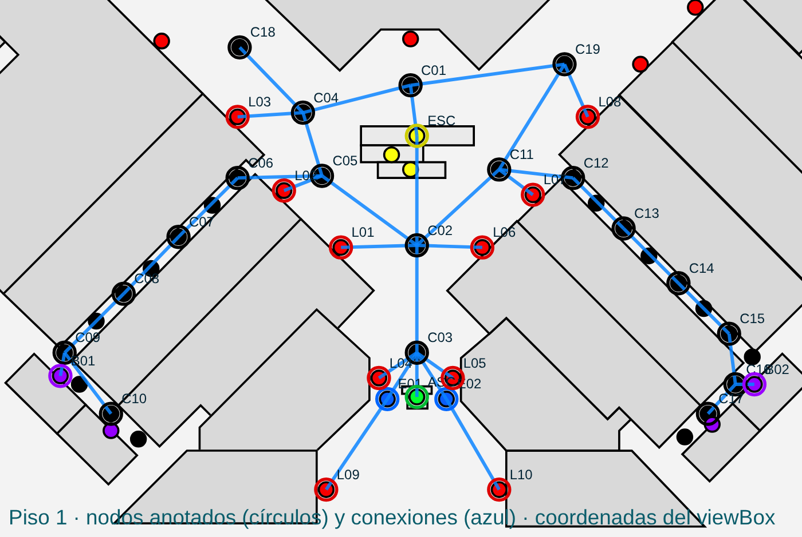{width=100%}

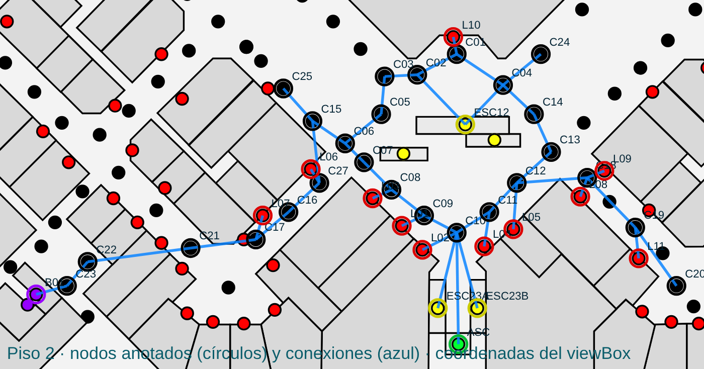{width=100%}

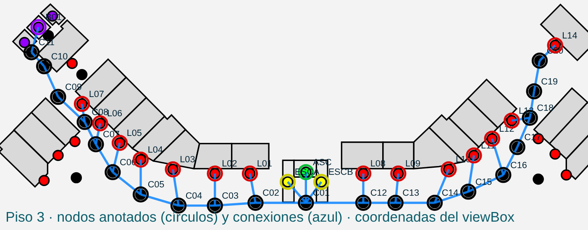{width=100%}

## Anexo C. Video de demostración

`docs/video/MallMapAI-demo.mp4` (39 s, 1280 × 720). Se grabó con Playwright sobre la aplicación real. **No tiene narración** (ni humana ni sintética): solo subtítulos en pantalla. La narración en vivo corresponde al guion de la sustentación.
