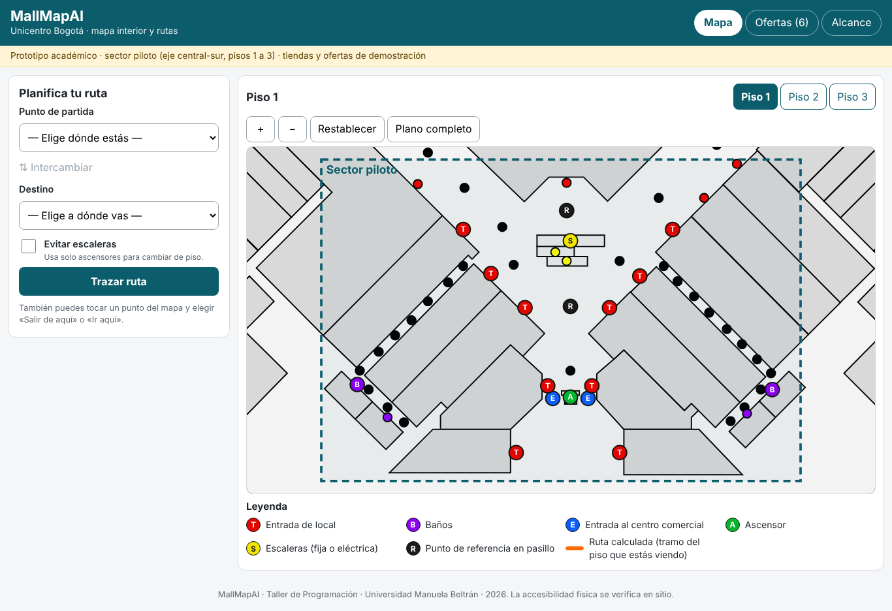
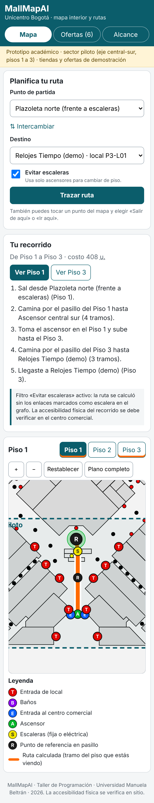
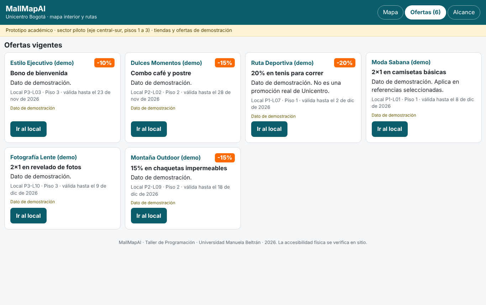

# Antes de empezar

- Abre MallMapAI en el navegador del computador o del celular (por ejemplo `http://localhost:3000`).
- Este prototipo cubre solo el **sector piloto**: el eje central-sur de los pisos 1, 2 y 3. En el mapa está marcado con una línea punteada.
- Los nombres de las tiendas y las ofertas son **de demostración**.
- La aplicación no sabe dónde estás. Tú eliges tu punto de partida.

En la parte de arriba hay tres pestañas: **Mapa**, **Ofertas** y **Alcance**.

# 1. Explorar el mapa

1. Entra a la pestaña **Mapa**.
2. Elige el piso con los botones **Piso 1**, **Piso 2** o **Piso 3**.
3. Acerca o aleja con **+** y **−**, con la rueda del mouse o pellizcando la pantalla del celular.
4. Arrastra el mapa para moverte.
5. Pulsa **Restablecer** para volver al sector piloto, o **Plano completo** para ver todo el piso.
6. Revisa la **leyenda** debajo del mapa. Cada punto tiene color y letra:

| Letra | Color | Significado |
|---|---|---|
| T | Rojo | Entrada de un local |
| B | Morado | Baños |
| E | Azul | Entrada al centro comercial |
| A | Verde | Ascensor |
| S | Amarillo | Escaleras (fija o eléctrica) |
| R | Negro | Punto de referencia en un pasillo |

Los puntos negros pequeños sin letra son marcas del plano original.

{width=95%}

**Con teclado:** haz clic en el mapa (o llega con Tab) y usa las flechas para moverte, **+** y **−** para el zoom y **0** para restablecer. Con Tab pasas por los puntos y con Enter los seleccionas.

# 2. Trazar una ruta

1. En **Punto de partida** elige dónde estás. Ejemplo: «Plazoleta norte (frente a escaleras)».
2. En **Destino** elige a dónde vas. Ejemplo: «Relojes Tiempo (demo) · local P3-L01».
3. Si no puedes o no quieres usar escaleras, marca **Evitar escaleras**.
4. Pulsa **Trazar ruta**.
5. En **Tu recorrido** aparecen los pasos numerados. Te dicen qué ascensor o escalera tomar y de qué piso a qué piso.
6. La ruta se dibuja en naranja sobre el mapa del piso que estás viendo. Usa **Ver Piso 1**, **Ver Piso 3**, etc., para ver cada tramo. En el selector de piso, los pisos de la ruta tienen una línea naranja.

{width=38%}

**Elegir desde el mapa:** toca un punto. Abajo aparece su nombre y dos botones: **Salir de aquí** (lo pone como punto de partida) e **Ir aquí** (lo pone como destino y, si ya tienes punto de partida, calcula la ruta).

**Si algo falta:** si no eliges destino o punto de partida, aparece un aviso amarillo que dice qué falta.

> «Evitar escaleras» quita las escaleras del cálculo. La accesibilidad real del camino se debe confirmar en el centro comercial.

# 3. Llegar a una oferta

1. Entra a la pestaña **Ofertas**. Cada tarjeta muestra la tienda, la promoción, el local, el piso y hasta cuándo es válida.
2. Pulsa **Ir al local** en la oferta que te interesa.
3. Se abre el mapa con ese local como destino.
   - Si ya habías elegido tu punto de partida, la ruta se calcula sola.
   - Si no, aparece el aviso «primero elige tu punto de partida» y el cursor queda en ese campo. Al elegirlo, la ruta se calcula sola.
4. Sigue los pasos de **Tu recorrido**.

{width=95%}

# 4. Si aparece un error

| Mensaje | Qué hacer |
|---|---|
| «No se pudo cargar el mapa» | Pulsa **Reintentar**. Si sigue, avisa al equipo: el servidor o la base pueden estar apagados. |
| «La base de datos no está disponible» | Espera unos segundos y pulsa **Reintentar**. |
| «No hay una ruta sin escaleras entre esos puntos» | Desmarca **Evitar escaleras** o elige otro destino. |
| «No hay ofertas vigentes en este momento» | No hay promociones activas hoy. Vuelve más tarde. |

# 5. Qué no hace todavía

No tiene cuentas de usuario, favoritos ni notificaciones. No detecta tu ubicación. Solo cubre el sector piloto.
